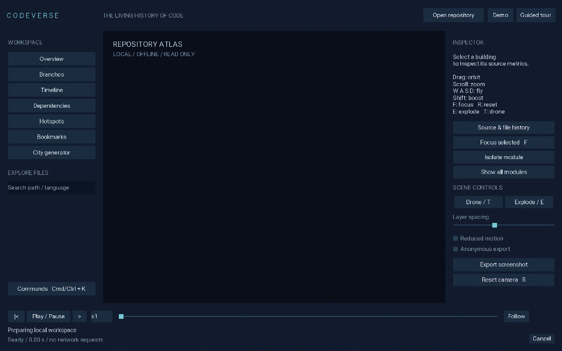
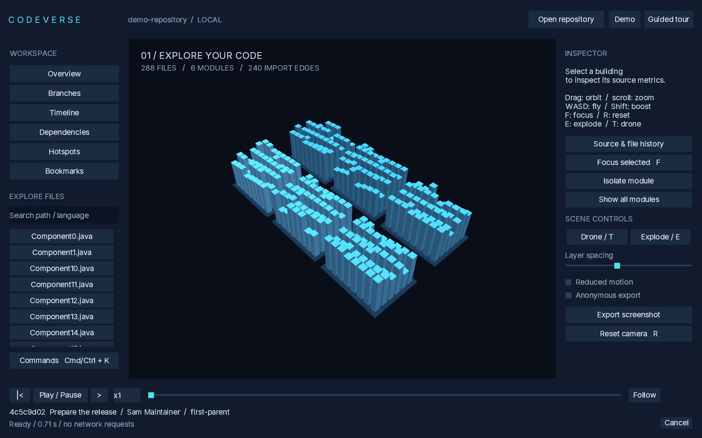
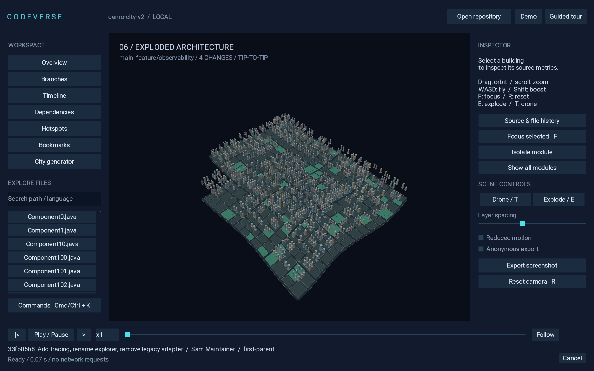
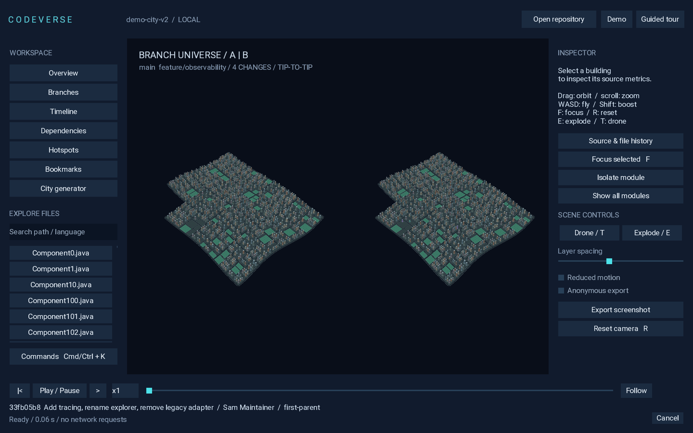

# CODEVERSE

**The living history of code.** An offline desktop explorer that turns a local Git repository into an interactive 3D city.



## Run

Open the self-contained `CODEVERSE.app` on macOS. No Java installation is needed for packaged applications. The first launch opens an app-owned demo with 288 Java files, 12 mainline commits and a feature branch. Click **Guided tour** for a repeatable tour, or **Open repository** to choose your own folder. Dropping a repository folder on the window also works.

To build from source, install JDK 25:

```sh
./gradlew test :desktop-ui:run
```

Windows: `gradlew.bat test :desktop-ui:run`. The first build downloads dependencies; the installed application works offline. `./gradlew :desktop-ui:installDist` produces launch scripts and all libraries. `python3 scripts/package.py --type app-image` bundles a runtime using `JAVA_HOME` (Temurin recommended). Native DMG/DEB installers are built by CI; Windows has a self-contained app image. Local macOS previews are ad-hoc signed, not Apple-notarized.

## Explore

- Buildings represent committed files; height is `clamp(8 + 16 × log2(1 + LOC), 8, 120)`. Folders are grouped into reserved parcels.
- Click a building or fuzzy-search a path to inspect LOC, source, history and change frequency.
- Timeline playback, step, scrub and x1/x4/x16 speeds use first-parent history by default. A full DAG listing exposes parent SHAs and merges.
- Compare branches in a stable overlay or synchronized split view. Choose tip-to-tip or merge-base semantics explicitly. Cyan means added, violet modified/renamed, red deleted.
- Drone tour visits change hotspots. Explode separates directory modules; Focus and Reset keep navigation usable.
- Java import heuristics power dependency reachability (depth 1–3), cycle membership and impact preview. These do not prove errors or represent runtime calls.
- Hotspots use 30/90/365-day windows, bounded to 2,000 first-parent commits. The inspector shows the metrics and window.
- Save/restore one viewpoint with its repository, commit, selection, camera and reserved layout. Export PNGs, optionally without identifying UI.

| Control | Action |
|---|---|
| Drag / scroll | Orbit / zoom |
| WASD / Shift | Fly / boost |
| F / R | Focus / reset |
| E / T | Explode / drone |
| Space | Play/pause history |
| Cmd/Ctrl+K | Commands |
| Tab / Shift+Tab / Enter | Navigate controls / activate |
| F3 | FPS, p95 frame time, heap usage |





## Data stays local

No server, account, API key, telemetry, checkout or repository code execution. Git objects are read through JGit. Bare repositories, detached HEAD, Unicode, merges, symlink entries, submodule entries and LFS pointers are handled without following or downloading their contents. Blobs above 1 MiB are not parsed; retained source is capped at 64 MiB per snapshot. Scans cap at 100,000 files and 2,000 commits. Scenes above 10,000 files render aggregates.

Cache, settings and demo data live in the platform application-data folder (`~/Library/Application Support/CODEVERSE` on macOS, `%LOCALAPPDATA%/CODEVERSE` on Windows, `$XDG_DATA_HOME/codeverse` or `~/.local/share/codeverse` on Linux). Cache contains source text; do not share it. Screenshot export warns before including names. See [SECURITY.md](SECURITY.md).

## Engineering

Six Gradle modules: `desktop-ui`, `renderer-3d`, `scene-model`, `git-indexer`, `code-analyzer`, `storage`. Java 25, libGDX 1.14.2, JGit 7.8.0, LWJGL 3.4.3 and SQLite. Versions and dependency lockfiles are committed. Import parsing is bounded and heuristic; repository work runs on a cancellable worker. Urban geometry uses static mesh batches; height changes and district separation run on the GPU. Camera position and look target use frame-rate-independent damping. Selection uses a shader uniform without rebuilding the city. The interface bundles Roboto.

Tests cover merge-base vs tip-to-tip, rename/add/delete/modify, native `git diff` agreement, bare/empty/detached repositories, cancellation, Unicode, binary/large/LFS/symlink entries, deterministic layout, persistent layout, 100k aggregation, dependency cycles and cache isolation.

[Measured benchmarks](docs/benchmarks.json): on an Apple M1 Pro, the 10,000-building renderer recorded p95 4.29 ms for the steady scene and 3.69 ms during drone/explode animation after warmup without VSync. A 10,000-file fixture took 538 ms to read; 2,000 commits from a 10,000-commit history took 720 ms. The history fixture uses unchanged trees and is not a worst-case churn benchmark. No claim is made about Windows GPU performance or all repositories.

```sh
./gradlew :git-indexer:benchmark
./gradlew :desktop-ui:run --args="--benchmark 10000 /tmp/codeverse-benchmark"
```

## Preview scope

This is a working **0.1.0 preview**, not the entire long-term roadmap. The native package version is 1.0.0 because macOS packaging rejects a leading zero; application/repository version remains 0.1.0. Full semantic multi-language analysis, an editable cinematic timeline, video encoding inside the app, build/test execution sandboxes, signed/notarized public releases, Windows MSI and screen-reader accessibility are not shipped. The DAG view is a parent-linked listing, not a graphical graph editor. Camera paths use smoothed orbit/focus transitions; full quaternion spline choreography remains future work.

MIT licensed. Third-party and runtime notices must remain with distributions; see [THIRD_PARTY_NOTICES.md](THIRD_PARTY_NOTICES.md).
